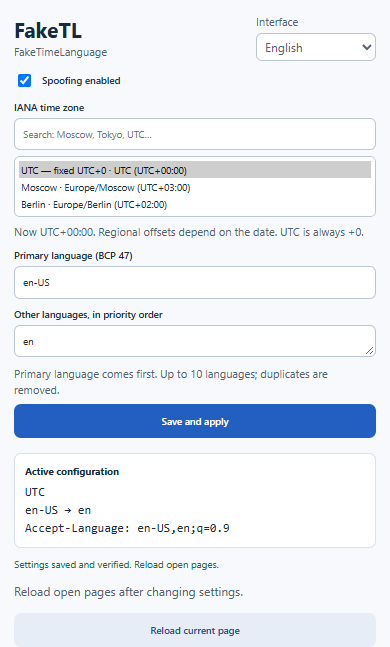

# FakeTL — FakeTimeLanguage

Приватный репозиторий: [rufpus/faketl](https://github.com/rufpus/faketl). Интерфейс расширения доступен на русском и английском; [English quickstart](#english-quickstart).

Работающее распакованное расширение **Google Chrome 138+**, Manifest V3. JavaScript, HTML и CSS; для самого расширения не нужны сборка, Node.js, npm-пакеты или подключение к внешним сервисам.

Начальные настройки: подмена включена, `UTC`, языки `en-US`, `en`. Для этой конфигурации HTTP-заголовок равен `Accept-Language: en-US,en;q=0.9`.

## Установка

1. Распакуйте архив, если используете ZIP. Папка должна содержать `manifest.json`, `background.js`, `settings.js`, `main.js`, `i18n.js` и файлы popup.
2. Откройте `chrome://extensions`, включите **«Режим разработчика»**.
3. Нажмите **«Загрузить распакованное расширение»**, выберите эту папку с `manifest.json`.
4. В карточке расширения откройте **«Подробнее»** и включите **«Разрешить пользовательские скрипты»**. Это отдельный переключатель Chrome 138+. До его включения popup сообщает, что применение не подтверждено.
5. В разделе доступа к сайтам разрешите работу на всех сайтах, которые хотите подменять. Для заявленной глобальной области действия нужен доступ ко всем HTTP/HTTPS-сайтам.
6. Откройте popup, нажмите **«Сохранить и применить»**, дождитесь подтверждения и перезагрузите страницы. При необходимости закрепите расширение на панели инструментов.

В popup есть включение подмены, поиск и выбор зоны, основной язык и остальные языки по приоритету, активная конфигурация и кнопка перезагрузки текущей страницы. Языки вводятся через запятую или по одному на строку. Проверка через `Intl.getCanonicalLocales` нормализует регистр и удаляет дубликаты; допускается 1–10 поддерживаемых Chrome тегов BCP 47. Расширение не добавляет исходные языки браузера. Качества остальных языков: `0.9`, `0.8`, …, `0.1`.

В списке зон показаны название на выбранном языке интерфейса, идентификатор IANA и смещение **на текущую дату**. Для региональной зоны оно может меняться. Постоянное UTC+0 — **`UTC`**. `Europe/London` летом обычно имеет другое смещение.

Селектор **«Интерфейс / Interface»** в шапке переключает popup между **Русский** и **English**. Язык интерфейса сразу сохраняется отдельно как `uiLanguage` в `chrome.storage.local`; кнопка сохранения и перезагрузка сайтов для этого не нужны. Переводятся подписи, поиск и названия зон, подсказки, статусы и сообщения об ошибках приложения. Изменение интерфейса сохраняет введённые несохранённые настройки и не меняет `navigator.languages`/Accept-Language сайтов. После обновления расширения существующие настройки зон и языков сохраняются.

После редактирования исходных файлов нажмите кнопку обновления расширения в `chrome://extensions`; простого обновления страницы сайта недостаточно для обновления кэшированного фонового кода.

## Как применяются настройки до скриптов сайта

`chrome.storage.local` хранит нормализованные настройки постоянно. Фоновый service worker читает их при установке, запуске и сохранении. Он заранее регистрирует **один скрипт `chrome.userScripts`** с `world: "MAIN"`, `runAt: "document_start"`, `allFrames: true`.

Скрипт содержит канонический JSON настроек и исходный `main.js` из локального пакета. Фоновый обработчик получает исходник через `chrome.runtime.getURL`, а не из сети. JSON никогда не становится произвольным пользовательским JavaScript. Зарегистрированный скрипт выполняется синхронно: ему не нужны `chrome.storage`, сообщения, DOM-вставка `<script>` или пробуждение фонового worker. `eval` и `Function` не используются. Единственный зарегистрированный блок также избегает дедупликации файлов Chrome между статическими и динамическими скриптами.

Регистрация готовится **до следующей навигации**, а не через `executeScript` после её обнаружения. В реальном Chrome 155 первый inline-скрипт в `<head>` уже видел выбранные значения, в том числе при строгой CSP тестовой страницы. Остановка фонового worker не нарушила эту проверку. Это существенно надёжнее асинхронного чтения хранилища при каждом `document_start`.

У `userScripts.register` нет параметров `matchOriginAsFallback` и `matchAboutBlank`. Для связанных документов есть дополнительный статический MAIN content script с `all_frames`, `match_about_blank`, `match_origin_as_fallback`. Он на `document_start` синхронно наследует неизменяемую публичную конфигурацию из доступного родителя или opener. На обычной странице без такой конфигурации он ничего не меняет. Он не предоставляет привилегированный канал сообщений.

**Границы раннего выполнения:** первая установка, обновление расширения, восстановление потерянной регистрации и изменение конфигурации требуют асинхронных API. Навигация во время этих операций может увидеть прежнюю или ещё не установленную конфигурацию. Между обновлением JS-регистрации, DNR и хранилища нет общей атомарной транзакции Chrome. После подтверждения сохранения перезагрузите страницы; не начинайте новую навигацию во время сохранения. BFCache и предварительно созданные документы тоже требуют перезагрузки. Синхронное чтение `iframe.contentWindow` непосредственно после создания начального пустого документа может опередить инъекцию. Для непрозрачных связанных origin наследование невозможно.

## Поддерживаемые интерфейсы

| Интерфейс | Поведение |
|---|---|
| `navigator.language`, `navigator.languages` | Основной язык и только выбранный упорядоченный список; массив заморожен |
| HTTP `Accept-Language` | Динамическое DNR-правило с операцией `set`; явно включены `main_frame`, `sub_frame` и остальные поддерживаемые типы HTTP/HTTPS-запросов |
| Intl с локалью по умолчанию | DateTimeFormat, NumberFormat, Collator, PluralRules, RelativeTimeFormat, ListFormat, DisplayNames, Segmenter и DurationFormat, когда API существует |
| Intl DateTimeFormat | Выбранная зона, если `timeZone` отсутствует или равен `undefined`; `resolvedOptions()` соответствует ей |
| Date local getters | Год, месяц, число, день недели, часы, минуты, секунды, миллисекунды, `getYear` и `getTimezoneOffset` |
| Date local strings | `toString`, `toDateString`, `toTimeString` и три `toLocale…` метода |
| Date local setters | `setFullYear`, `setMonth`, `setDate`, `setHours`, `setMinutes`, `setSeconds`, `setMilliseconds`, `setYear` |
| `new Date(y, m, …)` | Компоненты трактуются в выбранной зоне; поддержаны переполнение компонентов и особое правило годов 0–99 |
| ISO date-time без зоны | `new Date("2026-01-15T12:34:56")` и `Date.parse` используют выбранную локальную зону |
| Числа и строки | Локаль по умолчанию в Number/BigInt `toLocaleString`, String `localeCompare`, `toLocaleLowerCase`, `toLocaleUpperCase` |

Явные `locale` и `timeZone` сохраняются. `Intl.NumberFormat("de-DE")` остаётся немецким; `Intl.DateTimeFormat("en-US", {timeZone:"Asia/Tokyo"})` остаётся токийским. Пустой список локалей использует выбранные настройки. Объекты options не копируются через spread: сохраняются унаследованные значения, getters и штатная проверка параметров.

Смещение вычисляется оригинальным `Intl.DateTimeFormat` для **момента времени конкретного объекта Date**. Локальные компоненты переводятся обратно в момент времени с совместимым с Date разрешением переходов: первый момент при повторении времени, сдвиг вперёд на размер разрыва при отсутствующем времени. Например, в New York `2026-03-08 02:30` становится `03:30`, а `2026-11-01 01:30` выбирает первое вхождение.

`Date.now`, `getTime`, `valueOf`, `toISOString`, `Date.UTC`, UTC-getters и UTC-setters сохраняют момент времени и своё назначение. ISO-строки только с датой (`"2026-01-15"`) по стандарту остаются UTC. Даты с явным `Z`/смещением сохраняют timestamp. Сохраняются `instanceof`, наследование от Date, вызов `Date()` как функции, Invalid Date и типы штатных исключений. Проверены также границы диапазона Date. Оригинальные методы захвачены до подмены; внутренние вычисления не вызывают изменённые методы рекурсивно.

## Область действия и ограничения

- Обычные доступные HTTP/HTTPS-страницы, включая HTTP/HTTPS iframe другого origin, покрываются напрямую. В Chrome 155 фактически проверены также доступные `about:blank`, `srcdoc` и `blob:`.
- `data:` iframe с непрозрачным origin **не покрыт JS-подменой**: у него нет доступа к конфигурации родителя. То же ограничение относится к аналогичным sandbox-фреймам и недоступному opener. Не используется асинхронный мост, который создавал бы ложное обещание ранней подмены.
- Dedicated Worker, SharedWorker и Service Worker сайтов **не покрыты JS-подменой**. Их Date, Intl и navigator остаются исходными; это проверено отдельно. DNR применяется к доступным сетевым HTTP/HTTPS-запросам, включая сетевые загрузки worker-скриптов. Ответы, созданные Service Worker/CacheStorage без сетевого запроса, не получают новый HTTP-заголовок.
- **Temporal не подменяется**. В тестовом Chrome он доступен, и `Temporal.Now.timeZoneId()` показывал исходную зону. Его методы форматирования тоже не заявлены покрытыми.
- Нестандартный, зависящий от реализации разбор строк без зоны, например `"01/15/2026 12:00"` или строк с пробелом вместо `T`, делегируется оригинальному `Date.parse`. Он может использовать исходную зону Chrome. Для локального времени используйте стандартный ISO date-time с `T` или числовой конструктор; для момента времени — `Z`/явное смещение.
- Исторические смещения с секундами вычисляются по базе ICU Chrome. `getTimezoneOffset` может дать дробное число минут; строковый `GMT±HHMM` показывает минутную часть. Актуальность региональных правил зависит от базы часовых поясов установленного браузера.
- HTML controls `datetime-local`/date, CSS, интерфейс браузера, Intl.Locale как явный объект локали, будущие API, внутренние нативные механизмы и неизменённые контексты не покрыты. Сайт может применять язык аккаунта, cookies или собственные настройки.
- `chrome://`, страницы магазина Chrome и другие защищённые страницы, а также другие расширения, не покрыты. Доступ к сайту, отозванный пользователем или политикой организации, может остановить инъекции. Другая DNR-конфигурация/расширение может конфликтовать с заголовком.
- MAIN world доступен сайту: подмена обнаружима и может быть изменена/обойдена кодом страницы, ссылкой на оригиналы из другого realm или неподдерживаемым контекстом. Стандартные тексты исключений и внешний вид функций не гарантируются побайтно. Не обещается анонимность или неразличимость.
- Расширение не меняет настройки системы, IP, геолокацию, язык интерфейса Chrome и содержимое страниц. Уже открытые страницы после изменения или выключения требуют перезагрузки. HTTP-правило переключается сразу; JS в старых документах остаётся прежним до перезагрузки.

## Разрешения и ошибки

| Разрешение | Зачем |
|---|---|
| `storage` | Постоянные настройки и состояние незавершённого применения в `chrome.storage.local` |
| `userScripts` | Заранее зарегистрированный MAIN-скрипт с выбранными настройками |
| `declarativeNetRequestWithHostAccess` | Подмена одного заголовка на разрешённых HTTP/HTTPS-ресурсах |
| `http://*/*`, `https://*/*` | Работа на посещаемых сайтах и в доступных iframe |

Разрешения `tabs`, `activeTab`, `scripting`, `webRequest`, DNR feedback не запрашиваются. Для получения ID активной вкладки и `tabs.reload` отдельное разрешение `tabs` не нужно. Нет телеметрии, удалённого кода, внешних сервисов, `externally_connectable` или web-accessible ресурсов.

Фоновый обработчик принимает операции только из своего `popup.html` с проверкой ID и URL отправителя. Страница не может через сообщения менять настройки или выполнять операции расширения. Публичная конфигурация MAIN нужна только для связанных доступных фреймов и не предоставляет доступ к Chrome API.

Изменения сериализуются. До обновления сохраняется durable intent `pending`. После регистрации JS и обновления DNR проверяются фактические записи Chrome, затем фиксируются настройки. При ошибках регистрации, DNR или хранилища выполняется откат, popup показывает ошибку; при неполном откате это прямо указывается. Прерванное применение восстанавливается на следующем запуске фонового worker. При выключении удаляются и динамическое правило, и JS-регистрация.

## Проверка вручную

Нужен Node.js 20+ только для тестового сервера и тестов:

```powershell
node test-site/server.js
```

Откройте `http://127.0.0.1:8787/` в Chrome с установленным расширением. **HTTP-заголовок показывается из реального `req.headers` локального сервера**, включая навигацию и fetch; JavaScript проверяется в HTTP-документе, не в `chrome-extension://`. Страница показывает `early`, основной документ, фреймы и три вида worker. `/records` содержит последние полученные сервером заголовки. `/?csp=1` включает строгую тестовую CSP.

1. Сохраните `UTC`, `en-US`, `en` и перезагрузите страницу. Ожидайте `early.zone = UTC`, основной язык `en-US`, заголовок `en-US,en;q=0.9`; зимняя и летняя даты `12:34:56.789Z` должны иметь локальный час 12 и offset 0.
2. Сохраните `Europe/Moscow`: для обеих дат ожидайте час 15 и offset −180. Для `America/New_York`: зимой час 7 / offset 300, летом час 8 / offset 240.
3. Сравните `Intl`, локальные getters и строки Date. `explicit.locale` должен быть `de-DE`, `explicit.zone` — `Asia/Tokyo`; ISO, timestamp, valueOf и UTC-компоненты должны совпадать между конфигурациями.
4. Проверьте ранний скрипт и HTTP/HTTPS iframe. Отдельно посмотрите исходные значения в `data:`, workers и Temporal, чтобы видеть реальную границу покрытия.
5. В `chrome://extensions` откройте инспектор фонового service worker и остановите его кнопкой **Stop** в Application → Service Workers. Закройте инспектор и откройте новую тестовую страницу: подмена должна работать без worker. В автоматическом тесте дополнительно проверяется, что он остаётся остановленным.
6. Полностью закройте Chrome и откройте снова с тем же обычным профилем. Убедитесь, что настройки сохранены и первый скрипт новой страницы видит их. Этот сценарий обычной установки требует ручного подтверждения — ограничение среды проверки описано ниже.
7. Выключите подмену, сохраните и перезагрузите. Основной документ должен совпадать с исходными значениями workers; сервер должен снова получить исходный Accept-Language.

## Автоматические проверки

Без внешних зависимостей, 13 проверок:

```powershell
node --test tests/*.test.js
```

Проверяются валидация, UTC/Moscow/New York, DST, календарные границы, Invalid Date, типы ошибок и преобразования аргументов, числовой конструктор, наследование, явные options, границы Date, откат ошибок script/DNR/storage, незавершённая транзакция, выключение и запрет сообщений сайта. Это модульные проверки, отдельно от реального браузера.

Для интеграционных тестов нужен `playwright-core` **только как инструмент тестирования**, а также Chrome с поддержкой CDP `Extensions.loadUnpacked` и `Extensions.getExtensions` (в этой среде Chrome 155):

```powershell
npm install --no-save --package-lock=false playwright-core
$env:CHROME_PATH = 'C:\Program Files\Google\Chrome\Application\chrome.exe'
node tests/browser.mjs
```

В комплектной среде Codex тест также умеет использовать уже установленный Playwright. При другом расположении модуля задайте `PLAYWRIGHT_MODULE` — абсолютный путь к `playwright-core/index.mjs`. Тест запускает отдельный профиль `.test-profile/<timestamp>`, не изменяет основной профиль, слушает `127.0.0.1:8787`, включает нужные переключатели Chrome, пользуется настоящим расширением. Поставляемый `popup.html` открывается в отдельной вкладке: headless Playwright не предоставляет нативное окно browser action как Page. Через этот документ проверены сохранение и кнопка перезагрузки текущей HTTP-вкладки; внешний вид сохранён в `verification/popup.png`. Он **не задаёт timezoneId, locale, Accept-Language через Playwright**, не использует DevTools emulation и не внедряет shim тестовым инструментом. Профиль и `test-results/browser.json` создаются заново; после закрытия тестового Chrome временные профили можно удалить.

## Что проверено фактически

Дата проверки: **14 октября 2026**, Windows, **Chrome 155.0.8059.40**, изолированный headless-профиль. Исходные значения среды: русский список языков и `Europe/Moscow`.

Все 13 модульных тестов и 10 браузерных сценариев прошли для FakeTL 1.1.0. Подтверждены реальные заголовки навигации/fetch/iframe/скриптов/worker-скрипта, UTC, Москва и Нью-Йорк зимой/летом, согласованность Date/Intl/navigator, DST gaps/overlaps, сохранность timestamps/UTC и Date.now, явные locale/timeZone, ранний inline-скрипт, CSP, доступные связанные фреймы, остановка фонового worker, немецкая конфигурация, выключение и кнопка перезагрузки. Дополнительно проверены English/Русский, сохранение языка интерфейса после открытия popup и закрытия Chrome, перевод ошибки валидации и сохранность черновика/настроек сайтов при переключении. Исходные значения workers, Temporal и непрозрачного `data:` также зафиксированы. Краткое доказательство: `verification/browser-summary.json`; полный последний отчёт: `verification/browser-report.json`.

**Перезапуск проверен частично:** Chrome действительно закрывался и запускался заново; сохранённые настройки пережили закрытие. CDP `loadUnpacked` загружает расширение для текущей сессии, поэтому после запуска пришлось повторно загрузить пакет и применить сохранённые настройки. Это не подтверждает автоматическое восстановление регистрации при холодном старте обычной установки через UI. Восстановление после обновления расширения, отключения разрешения userScripts и аварийного завершения Chrome в реальном браузере, Chrome 138 и другие версии, инкогнито, внешние HTTPS-сайты, сложные sandbox/CSP/предварительно загруженные документы и все исторические изменения IANA не проверены. HTTP-тесты используют настоящую сетевую цепочку; для HTTPS объявлены те же supported matches и правила, но отдельного HTTPS-тестового сервера нет.

## Официальная документация, проверенная перед реализацией

- [chrome.userScripts](https://developer.chrome.com/docs/extensions/reference/api/userScripts): `code`, MAIN, `document_start`, регистрация и отдельное разрешение пользовательских скриптов с Chrome 138; регистрации очищаются при обновлении расширения.
- [Content scripts](https://developer.chrome.com/docs/extensions/develop/concepts/content-scripts) и [Manifest content_scripts](https://developer.chrome.com/docs/extensions/reference/manifest/content-scripts): порядок запуска, мир выполнения, all_frames и связанные фреймы.
- [chrome.scripting](https://developer.chrome.com/docs/extensions/reference/api/scripting): динамическая регистрация принимает пути к файлам, а поздний `executeScript` не решает передачу произвольной конфигурации до первого скрипта сайта.
- [chrome.declarativeNetRequest](https://developer.chrome.com/docs/extensions/reference/api/declarativeNetRequest): modifyHeaders/set, динамические правила, область типов запросов, взаимодействие с Service Worker. Динамические правила сохраняются между сессиями.

Минимальная версия 138 выбрана, чтобы опираться на per-extension переключатель userScripts и поддерживаемые MAIN/related-frame API. Она указана в manifest; проверка непосредственно на Chrome 138 остаётся открытой.

## English quickstart

**FakeTL (FakeTimeLanguage)** is a Manifest V3 Chrome extension that changes the preferred languages and time zone visible to websites through supported JavaScript APIs and the HTTP Accept-Language header. The extension itself has no build step, external dependencies, remote code or telemetry.

1. Use **Chrome 138 or newer**. Download/extract the repository or `FakeTL.zip`.
2. Open `chrome://extensions`, enable **Developer mode**, choose **Load unpacked**, and select the folder containing `manifest.json`.
3. Open the extension’s **Details** and enable **Allow User Scripts**. Allow access to the websites you want to cover.
4. Open FakeTL, choose **English** in the **Interface** selector, select an IANA time zone and ordered BCP 47 language tags, and click **Save and apply**.
5. Reload open pages. Use **UTC** for constant UTC+0; **Europe/London** has seasonal offsets.

The interface language is saved immediately and independently of spoofed website languages. Switching English/Russian preserves unsaved form edits. Existing time-zone/language preferences survive extension updates. Initial website settings are enabled, UTC, and `["en-US", "en"]`.

Run `node test-site/server.js` and visit `http://127.0.0.1:8787/` for server-received headers, the first inline page script, iframe results, and worker probes. Unit tests: `node --test tests/*.test.js`. Optional real-browser tests: install `playwright-core` for testing and run `node tests/browser.mjs`. No locale or time-zone emulation is used.

Coverage limits: workers, Temporal and opaque data frames retain original JavaScript values; implementation-dependent legacy date parsing is delegated to Chrome. This is detectable and does not change IP, geolocation, OS settings or the Chrome UI. All 13 unit tests and 10 integration scenarios passed in real Chrome 155 on Windows. The native browser-action window was not visually tested: integration tests open the shipped popup document in an extension tab. A real browser shutdown/restart preserved stored preferences, but the session-only CDP installation needed reloading, so automatic restoration of a normally installed unpacked extension at cold start remains unverified. Chrome 138, separate HTTPS integration tests and incognito also remain unverified. See the detailed Russian coverage and verification sections above.


